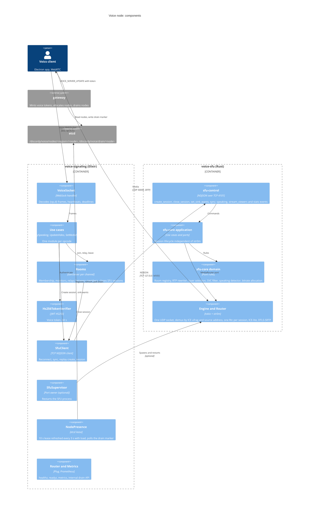

# Architecture

Voice is split in two processes per node so that media never waits on signaling and signaling can restart without dropping a call: **voice-signaling** (Elixir) speaks the client-facing protocol, **voice-sfu** (Rust) moves the RTP. They talk over a newline-delimited JSON socket on loopback (pinned interface P8). `regionctl` is an operator tool that edits the gitops repository.

## C4 component diagram

## Layers

Both services follow Clean Architecture; dependencies point inwards.

| Layer | signaling (`lib/discordy_voice`) | sfu (`crates`) |
|---|---|---|
| domain | `domain/`: frames, SSRC plan, codecs, room state, DAVE routing, node status | `sfu-core/src/domain`: RTP rewriter, layer selector, SVC filter, keyframe detection, room registry, speaking detector |
| application | `application/`: settings, ports, one use case per opcode | `sfu-core/src/application`: use case per command, ports (`MediaRouter`, `EventPublisher`) |
| infrastructure | `infrastructure/`: rooms, SFU client and supervisor, etcd, token verifier, counters | `sfu-core/src/infrastructure`: str0m router, UDP engine, STUN/ufrag demux; `sfu-control`: NDJSON server |
| interface | `interface/`: WebSocket, HTTP router, metrics | `bin/sfu`: configuration, operational HTTP |
| composition root | `composition_root.ex` | `bin/sfu/src/main.rs` |

## Join sequence

1. The gateway allocates a node (lowest `users` in the region, from etcd) and sends `VOICE_SERVER_UPDATE` with a 60 s HS256 token (`sub`, `sid`, `srv`, `chn`, `node`, `e2ee`).
2. The client opens `wss://<ws_url>/voice`. Signaling sends HELLO (heartbeat 13 750 ms). A connection that does not IDENTIFY within 10 s, or misses 2.5 heartbeat intervals, is closed. Each heartbeat replaces the timeout reference; a canceled timeout already queued in the mailbox cannot close the renewed session.
3. IDENTIFY: the token is verified and must match `user_id`, `session_id`, `server_id` and this node's id. A draining node answers close code 4011. The member joins its channel room and READY returns the server-assigned audio SSRC, the simulcast layers (`q`, `h`, `f`, each with an RTX SSRC) when the user publishes video, the UDP endpoint and the mode `dtls-srtp`. Existing members get CLIENTS_CONNECT, the newcomer gets the existing members and their VIDEO state.
4. SELECT_PROTOCOL carries ICE credentials, the DTLS fingerprint and codecs. Signaling sends `create_session`; the SFU answers with its ICE credentials and fingerprint (it is ICE-lite and DTLS passive) and signaling replies SESSION_DESCRIPTION. The client synthesizes the remote SDP from it.
5. Media flows client to SFU over the single UDP port. The SFU demultiplexes STUN by ICE ufrag and everything else by learned source address, and forwards every publisher to the other sessions of the room under the publisher's SSRCs, rewriting sequence numbers and timestamps so layer switches and DTX gaps are invisible to receivers.

## Media plane notes

- **Audio**: Opus is forwarded as is; 1-byte DTX comfort frames are dropped and absorbed by the rewriter. The audio-level header extension drives speaking detection (published to signaling as `speaking` events and relayed as SPEAKING).
- **Video**: each viewer picks quality per publisher through MEDIA_SINK_WANTS; the SFU combines it with a bandwidth estimate (TWCC and REMB) to select a simulcast layer, switching only on keyframes. A newly active layer triggers immediate allocation using its partial-window bitrate estimate, with a 100ms denominator floor to bound a single packet's estimate. Completed one-second measurements take precedence once available; node traffic metrics retain their completed-window semantics. VP9 sent as one SSRC with spatial layers (SVC) is filtered by layer instead. NACK, PLI and FIR are terminated or forwarded to the publisher with throttling. When a subscriber's transport becomes connected, every simulcast video restarts at its next keyframe and a keyframe is requested for each camera and watched screen share, unthrottled, because keyframes forwarded while the subscriber was still connecting never reached it (a rejoining viewer would otherwise see a black camera).
- **Screen share**: opt-in. A subscriber receives a publisher's screen stream only after MEDIA_SINK_WANTS lists its screen SSRC (from the VIDEO payload, `type: "screen"`) with a quality above 0; without it the packets are skipped and no bandwidth is used. The SFU tracks the opted-in users per screen share and sends a `stream_viewers` event when the set changes; signaling relays it to the streamer only, as op 40 `STREAM_VIEWERS` `{ssrc, user_ids}` (the complete viewer list, so an empty list means nobody watches).
- **E2EE (DAVE)**: when the token says `e2ee`, signaling announces an MLS external sender (op 25) and relays key packages, proposals, commits (announced as op 29), welcomes (op 30) and transition messages between members. Payloads are opaque to the server; it never holds group key material. The announced `protocol_version` is 2, the only version: it names the media frame layout the clients use (LiveKit-compatible, see the voice protocol page in the handbook), and clients refuse a call that announces another. Clients that join late receive a welcome from the member that commits. The server does not itself issue removal proposals (that needs an MLS implementation); remaining members' clients do.

## Failure handling

| Failure | Behaviour |
|---|---|
| SFU process dies | `SfuClient` reconnects with back-off; on connect it sends `sync` with its sessions. The SFU closes sessions signaling does not know and reports the ones it lost, which are replayed with `create_session` under their original ICE credentials. With `SFU_EXECUTABLE` set, `SfuSupervisor` restarts the process; otherwise the orchestrator restarts the container. A new SFU process has a new DTLS certificate, so clients must ICE-restart. |
| Signaling restarts | Sessions reconnect their WebSockets; `sync` with an empty list closes the SFU's orphans. |
| A client socket crashes | The room monitors member processes: the SFU session is closed and the others receive CLIENT_DISCONNECT. |
| etcd unreachable or lease lost | The lease is re-granted on the next 3 s tick. New IDENTIFY requests are refused until the node owns a fresh registration; the local lease deadline also fences a paused process. Existing calls are unaffected. |
| Duplicate node ID | Atomic etcd claim fails and the contender stays unready. Refresh and graceful deletion compare the owning lease, so a stale process cannot overwrite or delete a replacement. |
| Node drain | New IDENTIFYs are refused (close 4011); existing sessions continue. |

## Regions

Active media probes use a separate signing key and `purpose=probe` tokens bound to the current
live registration lease. Signaling derives a private room from that lease and a per-run UUID;
caller-provided server/channel IDs never select a user room. Probe sessions are audio-only and
may bypass draining only after authentication and lease checks. Ordinary call tokens retain
their existing key and behavior. `VOICE_REQUIRE_PROBE` defaults to false; this signaling support
does not start an observer or enable health enforcement. See central ADR-0025 and contracts PR45.

A region is a directory in the gitops repository (`regions/<name>/kustomization.yaml`) layered over `regions/_template`, plus a DNS record for its WebSocket host. `regionctl add` creates both, taking the next free `SNOWFLAKE_WORKER_ID` in 192-255 (P5). `regionctl drain <node_id>` calls the gateway's internal drain API; `regionctl drain --region <name>` records `VOICE_DRAIN_ON_START` in the overlay so the region's nodes boot draining.
